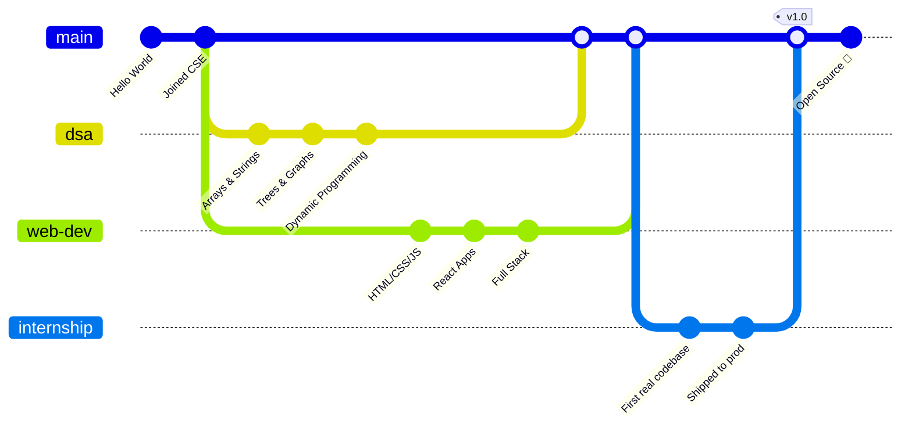
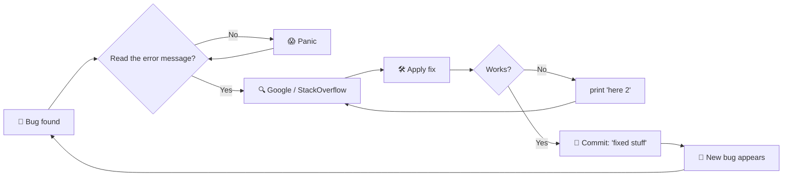

<!-- ═══════════════════════════════════════════════════════════════════
  🔧 SETUP: Find & Replace these placeholders across the file
     YOUR_USERNAME   → your GitHub username (repo must be named the same)
     Your Name       → your real name
     REPO_NAME       → a repo you want to feature (used in pin cards / badges)
     LEETCODE_USER   → your LeetCode username
═══════════════════════════════════════════════════════════════════ -->

<!-- ───────────────────────── HEADER ───────────────────────── -->

<div align="center">


<a href="https://git.io/typing-svg">
  
</a>

<br/>

<!-- Follow / social buttons -->
<a href="https://github.com/arnavranjan50?tab=followers"></a>
<a href="https://github.com/arnavranjan50?tab=repositories"></a>
<a href="https://www.linkedin.com/in/arnav-ranjan-972348207"></a>
<a href="mailto:arnavranjan50@gmail.com"></a>
<a href="https://arn-portfolio.vercel.app"></a>
<a href="https://twitter.com/arnavranjan50"></a>
<a href="https://leetcode.com/BraveGull"></a>
<a href="https://codeforces.com/profile/HairyBeetle"></a>

<br/><br/>


</div>

<!-- ───────────────────────── NAVIGATION ───────────────────────── -->

<div align="center">

<a href="#about"></a>
<a href="#stack"></a>
<a href="#projects"></a>
<a href="#stats"></a>
<a href="#commits"></a>
<a href="#dsa"></a>
<a href="#academics"></a>
<a href="#fun"></a>
<a href="#contact"></a>

</div>

---

<!-- ───────────────────────── ABOUT ───────────────────────── -->

<a id="about"></a>

## 👨‍💻 About Me

<table>
<tr>
<td width="55%" valign="top">

```bash
┌──(you㉿github)-[~/about]
└─$ cat profile.txt

 👤  Name        : Arnav Ranjan
 🎓  Degree      : B.Tech — Computer Science & Engineering(AI&ML)
 🏫  College     : Presidency University
 📅  Batch       : 2024 – 2028
 💼  Role        : Aspiring Software Development Engineer
 🔭  Building    : A full-stack project with real users
 🌱  Learning    : System Design, Docker, Cloud (AWS)
 🧩  Practicing  : DSA in C++ / Java / Python
 🤝  Open to     : Internships • Open Source • Hackathons
 ⚡  Fun fact    : Crime and Punishment Fyodor Dostoevsky
```

</td>
<td width="45%" valign="top" align="center">


<br/>


</td>
</tr>
</table>

```python
class Developer:
    def __init__(self):
        self.name = "Arnav Ranjan"
        self.branch = "Computer Science & Engineering(AI&ML)"
        self.languages = ["C", "C++", "Java", "Python", "JavaScript", "TypeScript"]
        self.interests = ["Web Dev", "DSA", "Open Source", "AI/ML", "System Design"]
        self.coffee_level = float("inf")

    def work_style(self):
        while True:
            self.learn()
            self.build()
            self.break_prod_then_fix()
            self.commit("fixed stuff")       # no one knows what stuff

me = Developer()
me.work_style()   # ⚠️ infinite loop — expected behaviour
```

---

<!-- ───────────────────────── TECH STACK ───────────────────────── -->

<a id="stack"></a>

## 🛠️ Tech Stack

<div align="center">

**Languages**


**Frontend**


**Backend & Databases**


**DevOps, Cloud & Tools**


**AI / ML**


</div>

<details>
<summary><b>📈 Skill Proficiency (click to expand)</b></summary>

<br/>

```text
C++            ██████████████████░░  90%
Python         █████████████████░░░  85%
Java           ████████████████░░░░  80%
JavaScript     ████████████████░░░░  80%
React          ███████████████░░░░░  75%
Node.js        ██████████████░░░░░░  70%
SQL / DBMS     ███████████████░░░░░  75%
Docker         ██████████░░░░░░░░░░  50%
System Design  ████████░░░░░░░░░░░░  40%   ← currently levelling up
```

</details>

---

<!-- ───────────────────────── PROJECTS ───────────────────────── -->

<a id="projects"></a>

## 🚀 Featured Projects

<div align="center">

<a href="https://github.com/arnavranjan50/Campus-Hustlers"></a>
<a href="https://github.com/arnavranjan50/arn-portfolio"></a>
<a href="https://github.com/arnavranjan50/VIBE-Player"></a>
<a href="https://github.com/arnavranjan50/ADAS---1.5"></a>

</div>

<br/>

| 🧪 Project | 📝 Description | 🧰 Stack | 🔗 Links |
|:--|:--|:--|:--:|
| **DevConnect** | Real-time developer networking platform with chat & code sharing | `React` `Node.js` `Socket.io` `MongoDB` | [](#) [](#) |
| **SmartCampus** | Attendance + timetable system using face recognition | `Python` `OpenCV` `Flask` `MySQL` | [](#) [](#) |
| **AlgoViz** | Interactive sorting & graph algorithm visualiser | `JavaScript` `Canvas` `Tailwind` | [](#) [](#) |
| **MiniOS-Sim** | CPU scheduling & memory management simulator in C++ | `C++` `OS Concepts` | [](#) |
| **SQL-Lens** | Natural-language → SQL query helper | `Python` `LLMs` `PostgreSQL` | [](#) |

---

<!-- ───────────────────────── GITHUB STATS ───────────────────────── -->

<a id="stats"></a>

## 📊 GitHub Analytics

<div align="center">


</div>

<details>
<summary><b>🏆 Trophy Cabinet (click to open)</b></summary>

<br/>

<div align="center">


</div>

</details>

---

<!-- ───────────────────────── COMMITS ───────────────────────── -->

<a id="commits"></a>

## 🟩 Commits & Contributions

<div align="center">


<br/><br/>

<!-- Contribution snake (needs .github/workflows/snake.yml) -->
<picture>
  <source media="(prefers-color-scheme: dark)" srcset="https://raw.githubusercontent.com/arnavrnajan50/arnavrnajan50/output/github-snake-dark.svg" />
  <source media="(prefers-color-scheme: light)" srcset="https://raw.githubusercontent.com/arnavranjan50/arnavranjan50/output/github-snake.svg" />
  
</picture>

</div>

### 🕒 Latest Activity (auto-updates every 30 min)

<!--START_SECTION:activity-->
1. 🎉 Merged PR #42 in `arnavranjan50/Campus-Hustlers`
2. 💪 Opened PR #43 in `arnavranjan50/VIBE-Player`
3. ❗ Closed issue #17 in `arnavranjan50/arn-portfolio`
4. 🗣 Commented on #12 in `open-source-org/awesome-project`
5. ⭐ Starred `torvalds/linux`
<!--END_SECTION:activity-->

### 🧾 `git log --oneline --graph`

```bash
$ git log --oneline --graph --decorate -n 8

* a3f9c21 (HEAD -> main, origin/main) feat: add dark mode toggle 🌙
* 7be41d0 fix: null pointer exception (classic) 🐛
* 5c8a1ef refactor: stop writing spaghetti code 🍝
|\
| * 91d0b7a (feature/auth) feat: JWT authentication
| * 2e6f3c8 test: add unit tests (finally)
|/
* d4a7e92 docs: update README (you're reading it!)
* 18bc045 fix: it works on my machine ¯\_(ツ)_/¯
* 0000001 initial commit — hello, world! 👋
```

<details>
<summary><b>🌳 My Journey as a Git Graph (rendered Mermaid)</b></summary>

<br/>



</details>

<details>
<summary><b>🐞 How I Debug (accurate flowchart)</b></summary>

<br/>



</details>

---

<!-- ───────────────────────── DSA ───────────────────────── -->

<a id="dsa"></a>

## 🧠 DSA & Competitive Programming

<div align="center">


</div>

| Platform | Profile | Badge |
|:--|:--|:--|
| 🟧 **LeetCode** | [`LEETCODE_USER`](https://leetcode.com/BraveGull) |  |
| 🟦 **Codeforces** | [`YOUR_USERNAME`](https://codeforces.com/profile/HairyBeetle) |  |
| 🟩 **GeeksforGeeks** | [`YOUR_USERNAME`](https://auth.geeksforgeeks.org/user/arnavraueyq) |  |
| 🟫 **CodeChef** | [`YOUR_USERNAME`](https://www.codechef.com/users/fair_wolves_49) |  |
| ⬛ **HackerRank** | [`YOUR_USERNAME`](https://www.hackerrank.com/trlalic1030u) |  |

<details>
<summary><b>🗺️ DSA Roadmap Checklist</b></summary>

<br/>

- [x] Arrays, Strings & Hashing
- [x] Recursion & Backtracking
- [x] Linked Lists, Stacks & Queues
- [x] Trees & BSTs
- [x] Heaps & Priority Queues
- [x] Graphs (BFS, DFS, Dijkstra, Union-Find)
- [x] Dynamic Programming (1D / 2D)
- [ ] Segment Trees & Fenwick Trees
- [ ] Advanced Graph Algorithms (SCC, Flows)
- [ ] Bit Manipulation Mastery

</details>

---

<!-- ───────────────────────── ACADEMICS ───────────────────────── -->

<a id="academics"></a>

## 🎓 Academics & Core CS

<div align="center">

| Core Subject | Status | Confidence |
|:--|:--:|:--|
| 🧮 Data Structures & Algorithms | ✅ Done | `██████████` 100% |
| 🖥️ Operating Systems | ✅ Done | `█████████░` 90% |
| 🗄️ DBMS | ✅ Done | `█████████░` 90% |
| 🌐 Computer Networks | ✅ Done | `████████░░` 80% |
| 🧱 Computer Organization & Architecture | ✅ Done | `███████░░░` 70% |
| 🤖 Theory of Computation | ✅ Done | `██████░░░░` 60% |
| 🛠️ Compiler Design | 🔄 In progress | `█████░░░░░` 50% |
| 🧠 Machine Learning | 🔄 In progress | `██████░░░░` 60% |
| 🏗️ Software Engineering | ✅ Done | `████████░░` 80% |

</div>

<details>
<summary><b>📚 Certifications & Courses</b></summary>

<br/>

- 🏅 **CS50x** — Harvard / edX
- 🏅 **Machine Learning Specialization** — Coursera (Andrew Ng)
- 🏅 **AWS Cloud Practitioner** — *in progress*
- 🏅 **Meta Front-End Developer** — Coursera
- 🏅 **NPTEL** — Data Structures & Algorithms (Elite)

</details>

---

<!-- ───────────────────────── FUN ZONE ───────────────────────── -->

<a id="fun"></a>

## 🎮 Fun Zone

<div align="center">


<br/>


</div>

<br/>

| 🎯 Fun Fact | 💬 Detail |
|:--|:--|
| ☕ Fuel | Chai ➜ Code ➜ Repeat |
| 🌙 Productive hours | 10 PM — 3 AM (sleep is a myth) |
| ⌨️ Editor wars | VS Code ✅ (Vim only to exit… eventually) |
| 🐧 OS | Linux, because I enjoy `sudo` powers |
| 🧠 Programming mantra | *"First make it work, then make it right, then make it fast."* |
| 🎵 Coding playlist | Lo-fi beats & synthwave |

<details>
<summary><b>🕹️ Click for a secret easter egg…</b></summary>

<br/>

```text
   ____          _        _
  / ___|___   __| | ___  | |    ___  _   _  ___
 | |   / _ \ / _` |/ _ \ | |   / _ \| | | |/ _ \
 | |__| (_) | (_| |  __/ | |__| (_) | |_| |  __/
  \____\___/ \__,_|\___| |_____\___/ \__,_|\___|

  You found it! 🎉  Star this repo and I'll owe you a chai ☕
  Konami code: ↑ ↑ ↓ ↓ ← → ← → B A
```

**Programmer's Rules**

1. It's not a bug, it's an undocumented feature.
2. If it works, don't touch it.
3. Always `git commit` before you break everything.
4. `rm -rf /` is **never** the answer.
5. There are 10 types of people: those who understand binary and those who don't.

</details>

---

<!-- ───────────────────────── CONTACT ───────────────────────── -->

<a id="contact"></a>

## 📬 Let's Connect

<div align="center">

**Open to internships • freelance • open-source collabs • hackathon teams**

<br/>

<a href="https://github.com/arnavranjan50"></a>
<a href="https://www.linkedin.com/in/arnav-ranjan/972348207"></a>
<a href="mailto:arnavranjan50@gmail.com"></a>
<a href="https://arn-portfolio.vercel.app"></a>

<br/><br/>

<a href="https://www.buymeacoffee.com/arnavranjan50"></a>
<a href="https://github.com/sponsors/arnavranjan50"></a>

<br/><br/>

*"Talk is cheap. Show me the code."* — Linus Torvalds

<br/>


</div>
